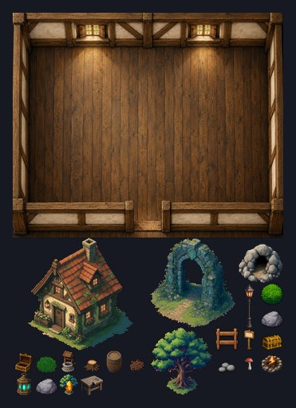
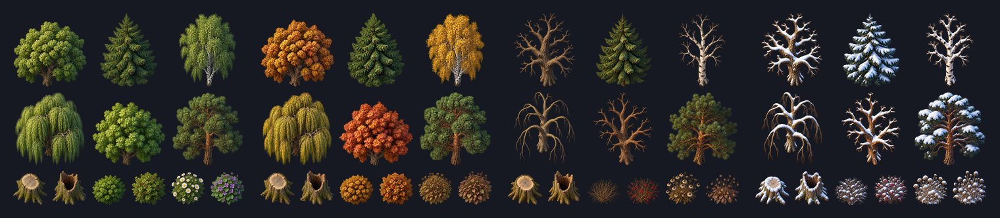

# Village Pack — art for RPG tile maps and battles

Reusable RPG art and objects: nine tilesets, walking sprites, battle artwork, one-time containers and editable woodland, snow, dust and rain profiles.

The pack owns reusable graphics, object templates and atmosphere profiles. Game maps, quests and rewards belong to `rpg_plus_game`.


## What is inside

### The village tileset

The `village` tileset is used by the village, forest and shrine maps. It has two parts.

Objects are placed on cells: a cottage, a shrine arch, a cave mouth, trees, bushes, a well, a campfire, lamp posts, a fence, a sign, barrels, chests (closed and open), a workbench and pick-ups such as brushwood, stones and a mushroom. At the top is the cottage interior, a single 12 × 10 room picture that the elder's house uses.



Surfaces are seamless ground textures that fill whole areas: grass, cobbled path, earth, pale stone floor, wooden floor, a rocky forest path and water.


Some tiles have extra properties for the RPG engine: water is solid, and lamps and windows carry a light that glows on the map at dusk and night.


### Seasonal vegetation

Four vegetation tilesets show the same trees, shrubs, stumps and flowers in summer, autumn, a bare late-autumn version and snowy winter: oak, spruce, birch, willow, maple and pine, round and berry shrubs, cut and hollow stumps, daisies and violets.



A map has one primary tileset for surfaces and may borrow objects from other tilesets through `Tilesets`. White Pass (`rpg_winter`), west of the desert, uses `snow` and borrows `vegetation_winter` and `village`.

### Desert and snow

- `desert`: sand and rocky surfaces with desert objects — adobe buildings, a market awning, palms, cacti and dry grass. RPG Plus's desert map, the Dry March, is painted with it.
- `snow`: A map has one primary tileset for surfaces and may borrow objects from other tilesets through `Tilesets`. White Pass (`rpg_winter`), west of the desert, uses `snow` and borrows `vegetation_winter` and `village`.


### Charsets: walking sprites

Each charset is a 3 × 4 sheet: three walking frames for each of four facings (down, left, right, up). The village set has a hero, an elder, a villager, a merchant, a slime and a wolf. The desert character set adds a scorpion and a beetle. Closed and open barrel artwork lives separately in `object_sprites/desert/`; barrels are objects, not characters. Each barrel state is a standalone 32×32 PNG containing one image. Only character walking sheets use the 3×4 layout.


### Battle portraits and backdrops

Large portraits show fighters in battle: the hero, the slime and the wolf, and the desert scorpion and beetle.


Three backdrops — a meadow, a forest and a desert outpost — are used as the background of a battle that starts on a map. The meadow and forest come with `_depth` companions for the lighting system.


## Where you see it

Village Pack is part of the `rpg_plus` game. In that game:

- the village, the elder's house, the forest and the woodland shrine are painted with the `village` tileset;
- the desert map uses `desert`;
- the elder, merchant, villagers, wolves, slimes, scorpions and beetles walk the maps with the pack's charsets;
- battles show the portraits, and the map scenes use `village/meadow`, `village/forest` or `desert/outpost` as the battle backdrop.

The tile map editor shows the selected tileset as its palette. Here the elder's house is open: the cottage interior, the objects and the surface swatches are the village tileset.


## Use it in your own RPG content

1. Include `village_pack` in your game's collection. It requires the `rpg` engine mod.
2. Add `village_pack>=1` to the `depends` list of the content mod that uses its art.
3. Refer to the art by name:

```jsonc
// A map: one tileset for the whole map
{ "Kind": "rpg_map", "Items": [ { "Id": "my_glade", "Tileset": "village" /* … */ } ] }
```

```jsonc
// A map event drawn with a charset
{ "Id": "old_man", "X": 5, "Y": 3, "Sprite": "village/elder" }
```

```jsonc
// A character's battle portrait
{ "Id": "my_wolf", "Image": "characters/village/wolf" }
```

```json
{
  "name": "my_glade",
  "defaultBackground": "village/meadow"
}
```

The tileset names are `village`, `vegetation_summer`, `vegetation_autumn`, `vegetation_bare`, `vegetation_winter`, `desert` and `snow`. Charsets are `village/<name>` and `desert/<name>`; backdrops are `village/meadow`, `village/forest` and `desert/outpost`.

The simplest way to paint is the RPG map editor: choose `village` as the map's tileset and paint with its palette instead of typing tile numbers.

## Limits and replacement

- A map has one primary tileset for surfaces and may borrow objects from other tilesets through `Tilesets`. White Pass (`rpg_winter`), west of the desert, uses `snow` and borrows `vegetation_winter` and `village`.
- The art has baked lighting and perspective. It is drawn for the 2.5D look; the isometric renderer reuses the same pictures, so very tall objects keep their painted angle.
- To replace a picture for your game, ship a file with the same relative name in your own mod and depend on `village_pack`. The later-loaded, dependent mod wins.
- The original generations, prompts and editable sources are archived outside the game; the mod contains only the runtime pictures and tileset definitions.

## If something looks wrong

1. A map with missing ground or objects usually has a misspelt `Tileset` name or a missing dependency.
2. An invisible character: check the `Sprite` name and that the charset sheet is 3 × 4 frames.
3. A battle with a plain background: the map scene has no `defaultBackground`.

## Reusable objects and atmosphere

In the map editor, open **Objects** and place `chest` or `village_pack/barrel`. Each instance has its own opened flag, empty message and open appearance. The template contains no currency or game-specific rewards: add them in the object editor or in the placed instance. Original template text is English; all seven languages use localization keys.

Select `woodland`, `winter_snow`, `desert_dust` or `rain` in the map’s Atmosphere field. Profiles are data in `atmospheres/weather.json`; duplicate one under a new Id to change particle counts, colors, sizes, heights and velocities. The picker lists profiles from all loaded mods. The Effects Engine owns the mechanism and supports new emitter factories; no biome names are built into either renderer.


## Snow enemies

The pack defines four reusable enemies, their battle portraits and transparent 3 × 4 walking sheets. All names are translated into the pack's seven languages.

| Character ID | Name | Level | HP | Defence | Attack | XP |
|---|---|---:|---:|---:|---:|---:|
| `village_pack/white_wolf` | White Wolf | 2 | 24 | 0 | 5 | 14 |
| `village_pack/walrus` | Walrus | 3 | 32 | 2 | 5 | 20 |
| `village_pack/polar_bear` | Polar Bear | 4 | 40 | 1 | 7 | 28 |
| `village_pack/yeti` | Yeti | 5 | 48 | 1 | 8 | 36 |

All use the existing attack/defend AI, one action point and zero recruitment chance. Their loot tables are empty so games can supply their own rewards through character patches. Wolf frames are 48 × 48 pixels; the other creatures use 64 × 64 frames. Rows are down, left, right, up; columns are stride, idle, stride. The map editor can place each definition as an enemy using its explicit `Charset`.

The patrols are placements in `rpg_plus_game` (`placements/rpg_winter/snow_enemies.json`): four short patrols on RPG Plus's White Pass, without replacing the map. Approach an enemy and press E/F to fight. Each victory hides that instance with its own saved flag; the entrance, return passage and containers stay accessible. The walrus patrols the frozen pond. The events are used only when a game supplies `rpg_winter`.

## Expanded settlements and shared interiors

Two additional tilesets, `habitat_objects` and `habitat_interiors`, contain 22 newly generated assets: six building facades, six room interiors, seven outdoor props and three furniture pieces. Timber homes and a woodland lodge extend the village and forest; adobe homes and a caravan inn serve the desert; a northern cabin and mountain lodge serve the snow biome. The objects include a market stall, stacked logs, a cistern, pottery, a cargo sled, a trail beacon and a shrine obelisk. Beds, tables and stoves remain independent objects.

The same PNG atlases work in both projections. Each 12 × 10 room has a measured source layout, a walkable floor, low side walls and a two-cell southern threshold. `IsoPlanes` maps those same source pixels onto floor and wall planes. The furniture has its own collision and depth anchor. Whole object groups retain contiguous atlas cells and shared sorting anchors.

Seven building instances are enterable through ordinary map teleports, including two instances of the woodland lodge with separate return destinations. Five outdoor maps are larger; their original events, spawn coordinates and transitions stay in place. New paths connect the districts, with complete seasonal vegetation groups around them.

| Map | Before | After |
|---|---:|---:|
| `rpg_village` | 32 × 18 | 64 × 42 |
| `rpg_forest` | 28 × 18 | 60 × 42 |
| `rpg_desert` | 40 × 24 | 72 × 48 |
| `rpg_winter` | 40 × 28 | 72 × 52 |
| `rpg_woodland_shrine` | 24 × 16 | 48 × 36 |

Runtime artwork and door events belong to this pack; expanded maps and interior scenes belong to `rpg_plus_game`. Raw sources, exact prompts, annotations and the deterministic builder are archived outside the repositories in `art_sources/cthangover/village_pack/art_sources/biome_expansion_20261029`.


### Desert oasis materials

The `desert` palette provides loose sand (0), rocky ground (1), pale oasis water (2, `water`, solid),
moist bank silt (3, `oasis_silt`, walkable), and compacted sandy trail (4, `desert_path`, walkable).
Paint these on the Back layer; the normal world-space diffusion blends boundaries in both projections.
The sample `rpg_desert` map contains an oasis around (25,24), a silt bank, and connecting trails.
