# Village Pack — art for RPG tile maps and battles

Village Pack is the art kit behind the RPG Plus world: tilesets to paint maps with, walking sprites for heroes, villagers and monsters, battle portraits and battle backdrops. Everything is drawn in one painterly 2.5D style, so maps built from it look like one world.

It is **art only**. The village, the elder's house, the forest and the desert you can walk through are maps and events from the RPG Demo and RPG Plus content mods; the walking, collisions and battles are the RPG engine. Village Pack supplies the pictures they use.

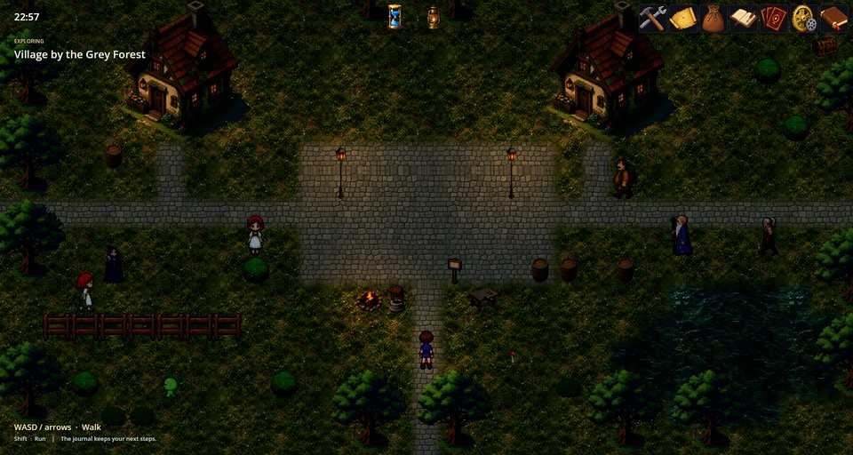

## What is inside

### The village tileset

The `village` tileset is used by every map of the demo world. It has two parts.

Objects are placed on cells: a cottage, a shrine arch, a cave mouth, trees, bushes, a well, a campfire, lamp posts, a fence, a sign, barrels, chests (closed and open), a workbench and pick-ups such as brushwood, stones and a mushroom. At the top is the cottage interior, a single 12 × 10 room picture that the elder's house uses.

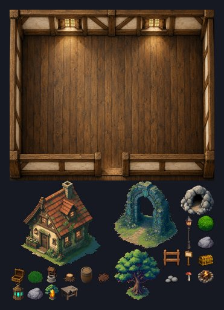

Surfaces are seamless ground textures that fill whole areas: grass, cobbled path, earth, pale stone floor, wooden floor, a rocky forest path and water.

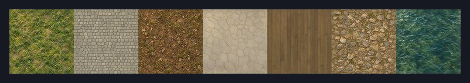

Some tiles have extra properties for the RPG engine: water is solid, and lamps and windows carry a light that glows on the map at dusk and night.

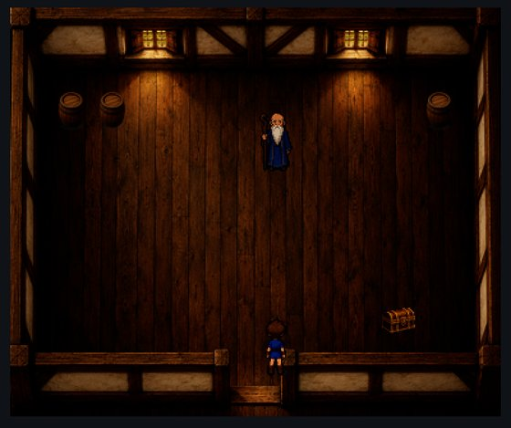

### Seasonal vegetation

Four vegetation tilesets show the same trees, shrubs, stumps and flowers in summer, autumn, a bare late-autumn version and snowy winter: oak, spruce, birch, willow, maple and pine, round and berry shrubs, cut and hollow stumps, daisies and violets.

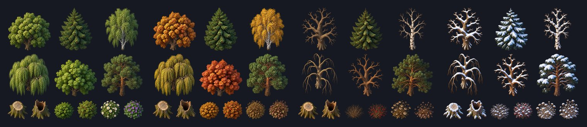

A map uses exactly one tileset, and none of the supplied maps uses the vegetation tilesets yet. They are ready material for a map author.

### Desert and snow

- `desert`: sand and rocky surfaces with desert objects — adobe buildings, a market awning, palms, cacti and dry grass. RPG Plus's desert map, the Dry March, is painted with it.
- `snow`: fresh snow, ice and two walked-on footpath surfaces (`packed_snow` and the more heavily scuffed `trampled_snow`), with a cabin, a cart, a well, rocks, shrubs and snowy spruces. No supplied map uses it yet.

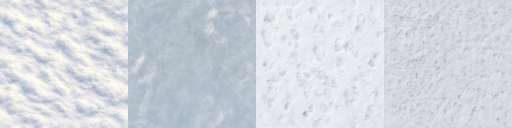

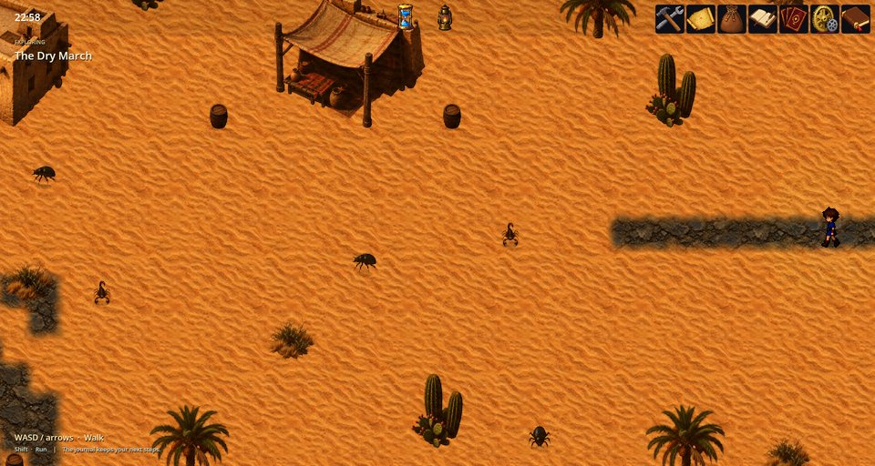

### Charsets: walking sprites

Each charset is a 3 × 4 sheet: three walking frames for each of four facings (down, left, right, up). The village set has a hero, an elder, a villager, a merchant, a slime and a wolf. The desert set adds a scorpion, a beetle and a barrel in closed and open states.

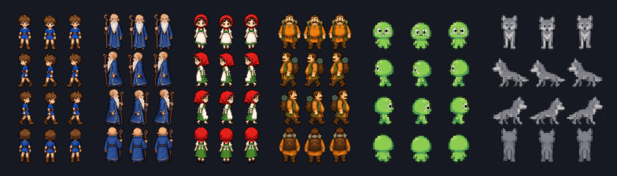

### Battle portraits and backdrops

Large portraits show fighters in battle: the hero, the slime and the wolf, and the desert scorpion and beetle.

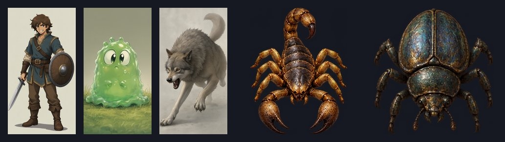

Three backdrops — a meadow, a forest and a desert outpost — are used as the background of a battle that starts on a map. The meadow and forest come with `_depth` companions for the lighting system.

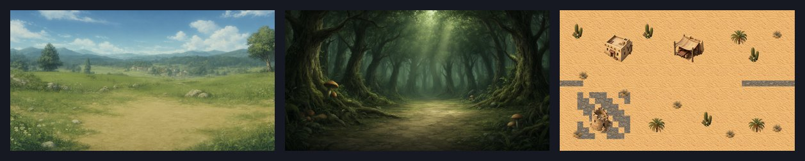


## Where you see it

Village Pack is part of the `rpg_plus` game. In that game:

- the village, the elder's house, the forest and the woodland shrine are painted with the `village` tileset;
- the desert map uses `desert`;
- the elder, merchant, villagers, wolves, slimes, scorpions and beetles walk the maps with the pack's charsets;
- battles show the portraits, and the map scenes use `village/meadow`, `village/forest` or `desert/outpost` as the battle backdrop.

The tile map editor shows the selected tileset as its palette. Here the elder's house is open: the cottage interior, the objects and the surface swatches are the village tileset.

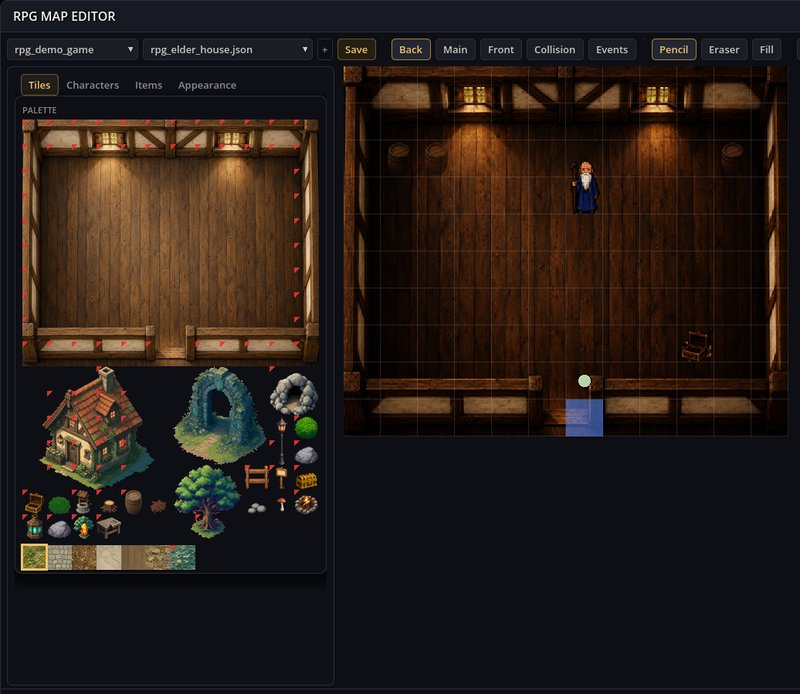

## Use it in your own RPG content

1. Include `village_pack` in your game's collection. It requires the `rpg` engine mod.
2. Add `village_pack>=1` to the `depends` list of the content mod that uses its art.
3. Refer to the art by name:

```jsonc
// A map: one tileset for the whole map
{ "Kind": "rpg_map", "Items": [ { "Id": "my_glade", "Tileset": "village" /* … */ } ] }
```

```jsonc
// A map event drawn with a charset
{ "Id": "old_man", "X": 5, "Y": 3, "Sprite": "village/elder" }
```

```jsonc
// A character's battle portrait
{ "Id": "my_wolf", "Image": "characters/village/wolf" }
```

```json
{
  "name": "my_glade",
  "defaultBackground": "village/meadow"
}
```

The tileset names are `village`, `vegetation_summer`, `vegetation_autumn`, `vegetation_bare`, `vegetation_winter`, `desert` and `snow`. Charsets are `village/<name>` and `desert/<name>`; backdrops are `village/meadow`, `village/forest` and `desert/outpost`.

The simplest way to paint is the RPG map editor: choose `village` as the map's tileset and paint with its palette instead of typing tile numbers.

## Limits and replacement

- One tileset per map. You cannot mix the village tileset and a vegetation tileset on the same map.
- The art has baked lighting and perspective. It is drawn for the 2.5D look; the isometric renderer reuses the same pictures, so very tall objects keep their painted angle.
- To replace a picture for your game, ship a file with the same relative name in your own mod and depend on `village_pack`. The later-loaded, dependent mod wins.
- The original generations, prompts and editable sources are archived outside the game; the mod contains only the runtime pictures and tileset definitions.

## If something looks wrong

1. A map with missing ground or objects usually has a misspelt `Tileset` name or a missing dependency.
2. An invisible character: check the `Sprite` name and that the charset sheet is 3 × 4 frames.
3. A battle with a plain background: the map scene has no `defaultBackground`.
