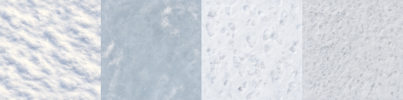
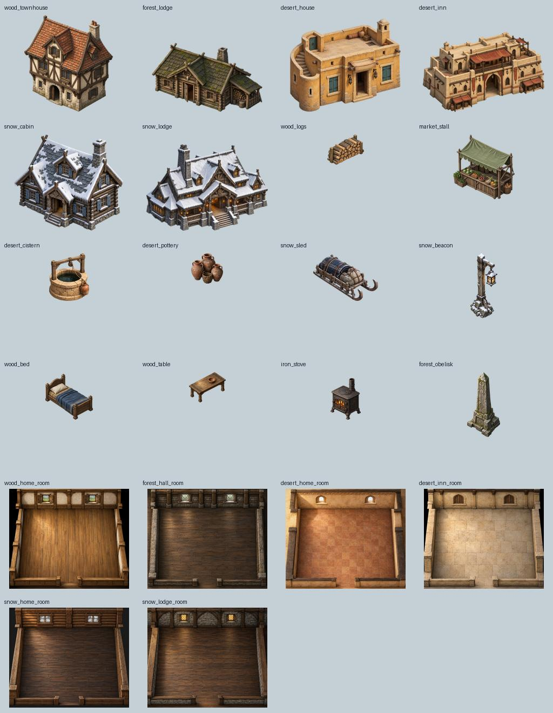

# Village Pack — arte para mapas RPG y batallas

Arte y objetos reutilizables para RPG: nueve tilesets, sprites, imágenes de batalla, contenedores de un solo uso y perfiles editables de bosque, nieve, polvo y lluvia.

El paquete contiene gráficos, plantillas de objetos y perfiles de ambiente reutilizables. Los mapas, misiones y recompensas pertenecen a `rpg_plus_game`.


## Qué contiene

### El tileset village

El tileset `village` lo usa cada mapa del mundo de la demo. Tiene dos partes.

Los objetos se colocan sobre casillas: una cabaña, un arco de santuario, la boca de una cueva, árboles, arbustos, un pozo, una hoguera, farolas, una valla, un cartel, barriles, cofres (cerrados y abiertos), una mesa de trabajo y objetos recogibles como leña, piedras y un champiñón. Arriba está el interior de la cabaña, una única imagen de sala de 12 × 10 que usa la casa del anciano.


Las superficies son texturas de suelo continuas que rellenan áreas enteras: hierba, camino adoquinado, tierra, suelo de piedra clara, suelo de madera, un sendero rocoso de bosque y agua.


Algunas tiles tienen propiedades extra para el motor RPG: el agua es sólida, y las farolas y ventanas llevan una luz que brilla en el mapa al anochecer y de noche.


### Vegetación estacional

Cuatro tilesets de vegetación muestran los mismos árboles, arbustos, tocones y flores en verano, otoño, una versión desnuda de finales de otoño e invierno nevado: roble, abeto, abedul, sauce, arce y pino, arbustos redondos y de bayas, tocones cortados y huecos, margaritas y violetas.


El mapa tiene un tileset principal para el suelo y puede tomar objetos de otros mediante `Tilesets`. Paso Blanco (`rpg_winter`), al oeste del desierto, usa `snow`, `vegetation_winter` y `village`.

### Desierto y nieve

- `desert`: superficies de arena y roca con objetos del desierto — edificios de adobe, un toldo de mercado, palmeras, cactus y hierba seca. El mapa desértico de RPG Plus, el Dry March, está pintado con él.
- `snow`: El mapa tiene un tileset principal para el suelo y puede tomar objetos de otros mediante `Tilesets`. Paso Blanco (`rpg_winter`), al oeste del desierto, usa `snow`, `vegetation_winter` y `village`.




### Charsets: sprites que caminan

Cada charset es una hoja de 3 × 4: tres fotogramas de caminar para cada una de las cuatro orientaciones (abajo, izquierda, derecha, arriba). El conjunto de la aldea trae un héroe, un anciano, un aldeano, un mercader, un slime y un lobo. El del desierto añade un escorpión, un escarabajo y un barril en estado cerrado y abierto.


### Retratos y fondos de combate

Los retratos grandes muestran a los combatientes en batalla: el héroe, el slime y el lobo, y el escorpión y el escarabajo del desierto.


Tres fondos —una pradera, un bosque y un puesto del desierto— sirven de fondo a una batalla que empieza en un mapa. La pradera y el bosque traen su compañero `_depth` para el sistema de iluminación.


## Dónde lo verás

Village Pack forma parte del juego `rpg_plus`. En ese juego:

- la aldea, la casa del anciano, el bosque y el santuario del bosque están pintados con el tileset `village`;
- el mapa del desierto usa `desert`;
- el anciano, el mercader, los aldeanos, los lobos, los slimes, los escorpiones y los escarabajos recorren los mapas con los charsets del paquete;
- las batallas muestran los retratos, y las escenas de mapa usan `village/meadow`, `village/forest` o `desert/outpost` como fondo de combate.

El editor de mapas muestra el tileset elegido como su paleta. Aquí está abierta la casa del anciano: el interior de la cabaña, los objetos y las muestras de superficie son el tileset village.


## Úsalo en tu contenido RPG

1. Incluye `village_pack` en la colección de tu juego. Requiere el mod de motor `rpg`.
2. Añade `village_pack>=1` a la lista `depends` del mod de contenido que use su arte.
3. Refiérete al arte por su nombre:

```jsonc
// Un mapa: un tileset para todo el mapa
{ "Kind": "rpg_map", "Items": [ { "Id": "my_glade", "Tileset": "village" /* … */ } ] }
```

```jsonc
// Un evento de mapa dibujado con un charset
{ "Id": "old_man", "X": 5, "Y": 3, "Sprite": "village/elder" }
```

```jsonc
// El retrato de combate de un personaje
{ "Id": "my_wolf", "Image": "characters/village/wolf" }
```

```json
{
  "name": "my_glade",
  "defaultBackground": "village/meadow"
}
```

Los nombres de tileset son `village`, `vegetation_summer`, `vegetation_autumn`, `vegetation_bare`, `vegetation_winter`, `desert` y `snow`. Los charsets son `village/<name>` y `desert/<name>`; los fondos de combate, `village/meadow`, `village/forest` y `desert/outpost`.

La forma más sencilla de pintar es el editor de mapas RPG: elige `village` como tileset del mapa y pinta con su paleta en lugar de teclear números de tile.

## Límites y sustitución

- El mapa tiene un tileset principal para el suelo y puede tomar objetos de otros mediante `Tilesets`. Paso Blanco (`rpg_winter`), al oeste del desierto, usa `snow`, `vegetation_winter` y `village`.
- El arte tiene la luz y la perspectiva horneadas. Está dibujado para el aspecto 2.5D; el renderizador isométrico reutiliza las mismas imágenes, así que los objetos muy altos conservan su ángulo pintado.
- Para sustituir una imagen en tu juego, incluye en tu mod un archivo con el mismo nombre relativo y declara dependencia de `village_pack`. Gana el mod dependiente, que se carga después.
- Las generaciones originales, los prompts y las fuentes editables están archivados fuera del juego; el mod contiene solo las imágenes listas para ejecutar y las definiciones de tileset.

## Si algo se ve mal

1. Un mapa sin suelo u objetos suele deberse a un nombre de `Tileset` mal escrito o a una dependencia que falta.
2. Un personaje invisible: comprueba el nombre de `Sprite` y que la hoja del charset sea de 3 × 4 fotogramas.
3. Una batalla con fondo liso: la escena del mapa no tiene `defaultBackground`.

## Objetos y ambiente reutilizables

En **Objetos** del editor coloca `chest` o `village_pack/barrel`. Cada instancia tiene su estado, mensaje vacío e imagen abierta. La plantilla no fija moneda ni recompensas: añádelas en el editor. El texto fuente es inglés; los siete idiomas usan claves de localización.

Elige `woodland`, `winter_snow`, `desert_dust` o `rain` en Ambiente. Duplica un perfil de `atmospheres/weather.json` con otro Id para cambiar partículas, colores, tamaños y velocidades. La lista incluye todos los mods cargados. Effects Engine permite añadir nuevos tipos de emisores sin cambiar los renderizadores.


## Enemigos de nieve

El paquete incluye lobo blanco, morsa, oso polar y yeti, con nombres en siete idiomas, retratos de combate y hojas de movimiento transparentes de 3 × 4. Sus ID son `village_pack/white_wolf`, `village_pack/walrus`, `village_pack/polar_bear` y `village_pack/yeti`.

Patrullan el Paso Blanco (`rpg_winter`). Acércate y pulsa E/F para combatir; cada enemigo desaparece tras la victoria y el resultado se conserva al guardar. Usan ataque y defensa; no se pueden reclutar. El juego puede definir el botín mediante parches. Los valores de salud/ataque/defensa/experiencia son 24/5/0/14, 32/5/2/20, 40/7/1/28 y 48/8/1/36, respectivamente.

## Asentamientos e interiores ampliados

Los tilesets `habitat_objects` y `habitat_interiors` añaden 22 recursos: seis fachadas, seis interiores, siete objetos exteriores y tres muebles. La aldea y el bosque reciben casas de madera; el desierto, casas de adobe y una posada; la nieve, una cabaña y un refugio de montaña. Los mismos PNG sirven para ambas proyecciones. Cada sala de 12 × 10 tiene suelo, paredes y un umbral de dos casillas, con planos `IsoPlanes` y muebles independientes.

Hay siete edificios accesibles y cinco mapas ampliados: aldea 64 × 42, bosque 60 × 42, desierto 72 × 48, nieve 72 × 52 y santuario 48 × 36. Se conservan los eventos y transiciones originales. Las puertas están en este paquete; los mapas y escenas interiores, en `rpg_plus_game`.


