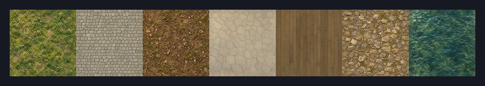

# Village Pack — RPG マップとバトルのアート

再利用できる RPG 素材とオブジェクト。9種のタイルセット、歩行スプライト、戦闘画像、一度だけ開く容器、編集可能な森林・雪・砂塵・雨のプロファイル。

パックは共通の画像、オブジェクトのテンプレート、環境プロファイルを提供します。ゲームのマップ、クエスト、報酬は `rpg_plus_game` にあります。


## 収録内容

### village タイルセット

デモ世界のすべてのマップが `village` タイルセットを使います。二つの部分からなります。

オブジェクトはセルに置かれます：コテージ、祠のアーチ、洞窟の入り口、木々、茂み、井戸、焚き火、街灯、柵、看板、樽、宝箱（閉じた状態と開いた状態）、作業台、そして薪・石・キノコのような拾える物。一番上にはコテージの内装——長老の家が使う、1枚の 12 × 10 の部屋画像があります。


サーフェスは領域全体を埋めるシームレスな地面テクスチャです：草、石畳の道、土、明るい石の床、木の床、岩の多い森の小道、水。



いくつかのタイルには RPG エンジン用の追加プロパティがあります：水は通行不可、街灯と窓は光源を持ち、夕暮れや夜にマップ上で光ります。


### 季節の植生

4つの植生タイルセットは、同じ木々・茂み・切り株・花を、夏、秋、葉のない晩秋、雪の冬で表現します：オーク、トウヒ、シラカバ、ヤナギ、カエデ、マツ、丸い茂みとベリーの茂み、切り株と洞のある切り株、ヒナギクとスミレ。


地面には1つの主タイルセットを使い、`Tilesets` で他のセットのオブジェクトを借りられます。砂漠の西にある白い峠（`rpg_winter`）は `snow` と `vegetation_winter`、`village` を使います。

### 砂漠と雪

- `desert`：砂と岩のサーフェスに、砂漠のオブジェクト——日干しレンガの建物、市場の日除け、ヤシ、サボテン、枯れ草——が付きます。RPG Plus の砂漠マップ Dry March はこれで描かれています。
- `snow`: 地面には1つの主タイルセットを使い、`Tilesets` で他のセットのオブジェクトを借りられます。砂漠の西にある白い峠（`rpg_winter`）は `snow` と `vegetation_winter`、`village` を使います。


### キャラチップ：歩行スプライト

各キャラチップは 3 × 4 枚のシートです：4方向（下・左・右・上）それぞれに歩行3フレーム。村のセットには主人公、長老、村人、商人、スライム、狼がいます。砂漠のセットにはサソリ、甲虫、そして閉じた状態と開いた状態の樽が加わります。


### バトル肖像と背景

大きな肖像は戦闘中の戦い手を示します：主人公、スライム、狼、そして砂漠のサソリと甲虫。


草原・森・砂漠の前哨の3枚の背景が、マップ上で始まった戦闘の背景として使われます。草原と森にはライティングシステム用の `_depth` が付いています。


## どこで見られるか

Village Pack は `rpg_plus` ゲームの一部です。そのゲームでは：

- 村、長老の家、森、森の祠は `village` タイルセットで描かれ、
- 砂漠マップは `desert` を使い、
- 長老・商人・村人・狼・スライム・サソリ・甲虫がパックのキャラチップでマップを歩き、
- 戦闘では肖像が表示され、マップのシーンは `village/meadow`、`village/forest`、`desert/outpost` を戦闘背景にします。

タイルマップエディターは、選択したタイルセットをパレットとして表示します。これは長老の家を開いたところ：コテージの内装、オブジェクト、サーフェスの見本が village タイルセットです。


## 自分の RPG コンテンツで使う

1. 自分のゲームのコレクションに `village_pack` を含めます。エンジン MOD `rpg` が必要です。
2. そのアートを使うコンテンツ MOD の `depends` リストに `village_pack>=1` を追加します。
3. アートは名前で参照します：

```jsonc
// マップ：マップ全体で1つのタイルセット
{ "Kind": "rpg_map", "Items": [ { "Id": "my_glade", "Tileset": "village" /* … */ } ] }
```

```jsonc
// キャラチップで描かれたマップイベント
{ "Id": "old_man", "X": 5, "Y": 3, "Sprite": "village/elder" }
```

```jsonc
// キャラクターのバトル肖像
{ "Id": "my_wolf", "Image": "characters/village/wolf" }
```

```json
{
  "name": "my_glade",
  "defaultBackground": "village/meadow"
}
```

タイルセットの名前は `village`、`vegetation_summer`、`vegetation_autumn`、`vegetation_bare`、`vegetation_winter`、`desert`、`snow` です。キャラチップは `village/<name>` と `desert/<name>`、バトル背景は `village/meadow`、`village/forest`、`desert/outpost` です。

いちばん簡単な描き方は RPG マップエディターです。マップのタイルセットに `village` を選べば、タイル番号を打ち込む代わりにパレットで描けます。

## 制限と差し替え

- 地面には1つの主タイルセットを使い、`Tilesets` で他のセットのオブジェクトを借りられます。砂漠の西にある白い峠（`rpg_winter`）は `snow` と `vegetation_winter`、`village` を使います。
- アートには光と遠近が焼き込まれています。2.5D の見た目のために描かれており、アイソメトリックレンダラーも同じ絵を再利用するため、非常に高いオブジェクトは描かれた角度を保ちます。
- 自分のゲーム向けに絵を差し替えるには、同じ相対名のファイルを自分の MOD に置き、`village_pack` に依存します。後から読み込まれる依存側が勝ちます。
- 元の生成画像・プロンプト・編集可能なソースはゲームの外にアーカイブされています。MOD に入っているのは実行用の絵とタイルセット定義だけです。

## 表示がおかしいとき

1. 地面やオブジェクトのないマップは、たいてい `Tileset` 名の打ち間違いか依存関係の欠落です。
2. キャラクターが見えない：`Sprite` 名と、キャラチップのシートが 3 × 4 フレームかを確認してください。
3. 戦闘の背景が無地：マップのシーンに `defaultBackground` がありません。

## 共通オブジェクトと環境

マップエディターの**オブジェクト**から `chest` または `village_pack/barrel` を置きます。開封状態、空のメッセージ、開いた画像は各インスタンスで独立します。通貨や報酬はエディターで設定します。原文は英語、7言語はローカライズキーを使います。

環境欄で `woodland`、`winter_snow`、`desert_dust`、`rain` を選びます。`atmospheres/weather.json` のプロファイルを新しい Id で複製し、粒子数・色・大きさ・高さ・速度を変更できます。全MODのプロファイルが一覧に出ます。Effects Engine で新しいエミッターを追加でき、レンダラーの変更は不要です。


## 雪原の敵

白狼、セイウチ、ホッキョクグマ、イエティを収録。名前は7言語に対応し、戦闘用画像と透過背景の3 × 4歩行シートを備えます。IDは順に `village_pack/white_wolf`、`village_pack/walrus`、`village_pack/polar_bear`、`village_pack/yeti` です。

白い峠（`rpg_winter`）を巡回します。近づいてE/Fで戦闘し、勝利すると倒した個体が消え、セーブ後も状態が維持されます。攻撃と防御を使用し、仲間にはできません。戦利品はゲーム側のパッチで設定できます。HP/攻撃/防御/経験値は順に24/5/0/14、32/5/2/20、40/7/1/28、48/8/1/36です。

## 拡張された集落と共通内装

`habitat_objects`と`habitat_interiors`に22素材を追加しました。外観6種、内装6種、屋外小物7種、家具3種です。村と森には木造住宅、砂漠には日干しレンガの家と隊商宿、雪原には小屋と山荘を配置。同じPNGを通常表示とアイソメトリック表示で使用します。12 × 10の各部屋は床・壁・2マス幅の南側出入口を`IsoPlanes`で対応づけ、家具は独立しています。

7棟に出入りできます。村64 × 42、森60 × 42、砂漠72 × 48、雪原72 × 52、聖域48 × 36に拡張し、既存イベントと移動先は元の座標を維持しています。扉イベントは本パック、マップと内装シーンは`rpg_plus_game`にあります。


