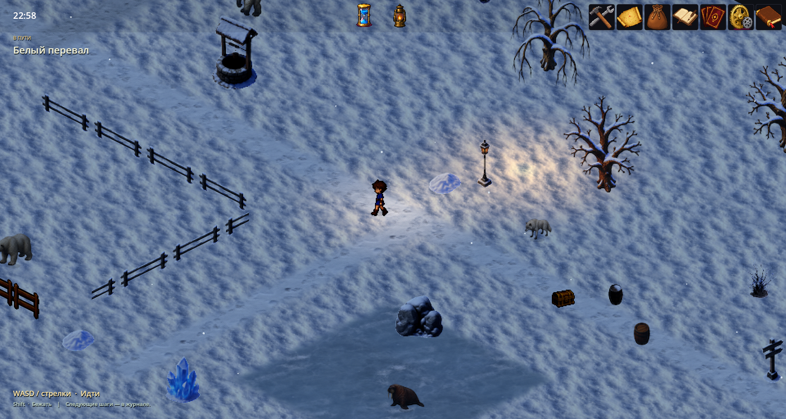

# Village Pack — 재사용 가능한 RPG 물체와 그래픽

Village Pack은 `rpg_object` 정의, `rpg_images/`의 개별 PNG, 걷기 시트, 전투 그래픽, 설원 적과 분위기 프로필을 제공합니다. `rpg`, `effects_base`에 의존합니다. 맵, 이야기, 배치, 보상은 RPG Plus가 제공합니다.

## 물체와 계절

지면에는 풀, 포장, 흙, 바닥, 숲길, 모래, 바위, 오아시스 물과 진흙, 눈, 얼음이 있습니다. 건물, 실내, 가구, 용기, 식물, 조명, NPC는 `objects/*.json`의 일반 물체입니다. 한 맵에서 여러 팩의 물체를 함께 사용할 수 있습니다.

계절 식물은 같은 물체의 `Variants`를 씁니다. `village_pack/vegetation/oak`에는 `autumn`, `bare`, `winter`가 있고 기본은 여름입니다. 맵 또는 배치에서 고릅니다. 현재 모델은 `Legend`, `Ground`, `Structure`, `rpg_placement`를 사용하며 타일셋 팔레트, 숫자 타일 ID, 스프라이트 아틀라스는 사용하지 않습니다.

## 사용하기

게임에 `village_pack`을 포함하고 콘텐츠 모드 의존성에 `village_pack>=0.1.0`을 추가하세요. 맵 편집기의 지면, 세그먼트, 스프라이트, 액터 탭에서 고릅니다. 최소 맵 파일 `maps/my_glade.json`:

```json
{
  "Kind": "rpg_map",
  "Items": [{
    "Id": "my_glade", "Width": 4, "Height": 3,
    "Legend": {"g": "village_pack/ground/grass"},
    "Ground": ["gggg", "gggg", "gggg"],
    "Spawn": {"X": 0, "Y": 0, "Dir": "Down"}
  }]
}
```

`placements/my_glade/props.json`의 통:

```json
{
  "Kind": "rpg_placement",
  "Items": [{
    "Id": "my_glade/barrel", "Object": "village_pack/container/barrel",
    "X": 1, "Y": 1
  }]
}
```

`my_glade` 씬과 `Charset`이 있는 리더도 필요합니다. 파트 이미지는 `rpg_images/` 기준 이름(예: `ground/grass`)이며 `.png`를 생략합니다. 물체 ID, 이미지 이름, 걷기 시트 이름은 서로 다른 키입니다.

## 용기와 실내

공용 용기는 `village_pack/chest`, `village_pack/container/barrel`입니다. 명령이 `self.open`을 설정하면 열린 상태가 이미지와 상호작용을 바꿉니다. 템플릿에는 보상이 없습니다. 자신의 물체나 배치에 보상을 넣되 열린 플래그와 상태를 유지하여 중복 획득을 막으세요.

공용 방 6개와 오두막 방은 물체입니다. `Footprint`가 충돌을 정하고 `Parts`는 탑다운 전체 이미지와 `Only`로 `isometric`에 한정한 잘라낸 `quad` 면을 씁니다. 공용 방 6개는 12 × 10칸이며 남쪽에 2칸 입구가 있습니다. 문 목적지와 실내 씬은 게임이 정합니다.

## 걷기와 전투

걷기 시트는 3열 × 4행(아래, 왼쪽, 오른쪽, 위)이며 가운데 열이 정지입니다. 캐릭터나 액터의 `Charset`에 `village/hero`, `village/villager`, `snow/white_wolf` 등을 씁니다. 전투 초상화는 `Image`(예: `characters/village/wolf`), 배경은 `village/meadow`, `village/forest`, `desert/outpost`입니다.

설원 적은 `characters/snow/enemies.json`에 있습니다. 아래 XP는 전투 보상 계산 전 `Exp` 값입니다:

- `village_pack/white_wolf`: Lv 2 · HP 24 · DEF 0 · ATK 5 · XP 14.
- `village_pack/walrus`: Lv 3 · HP 32 · DEF 2 · ATK 5 · XP 20.
- `village_pack/polar_bear`: Lv 4 · HP 40 · DEF 1 · ATK 7 · XP 28.
- `village_pack/yeti`: Lv 5 · HP 48 · DEF 1 · ATK 8 · XP 36.

모두 1 AP, 영입 확률 0, 빈 전리품 목록입니다. 늑대 걷기 프레임은 48 × 48픽셀, 나머지는 64 × 64입니다. RPG Plus가 `placements/rpg_winter/snow_enemies.json`에 순찰을 배치하고 승리 플래그를 정합니다.

## 분위기와 교체

`woodland`, `winter_snow`, `desert_dust`, `rain`은 `atmospheres/weather.json`에 있습니다. 맵의 `Atmosphere`에서 고르거나 맵 편집기 효과 도구로 마스크를 칠하세요. Effects Engine이 재생하고 Effects Editor가 편집합니다.

원 소유자에 의존하는 모드에서 같은 종류와 ID의 엔티티, 또는 같은 이름의 이미지를 제공하면 교체합니다. 개별 필드는 패치를 쓰세요. 원본 생성 이미지와 편집 가능한 자료는 저장소 밖에 보관합니다.



물체가 없으면 `Object`, 이미지 키, 의존성을 확인하세요. 길이 막히면 `Footprint.Solid`와 맵 충돌을 확인하세요. 걷기에는 `Charset`, 전투 배경에는 맵 씬의 `defaultBackground`가 필요합니다.
