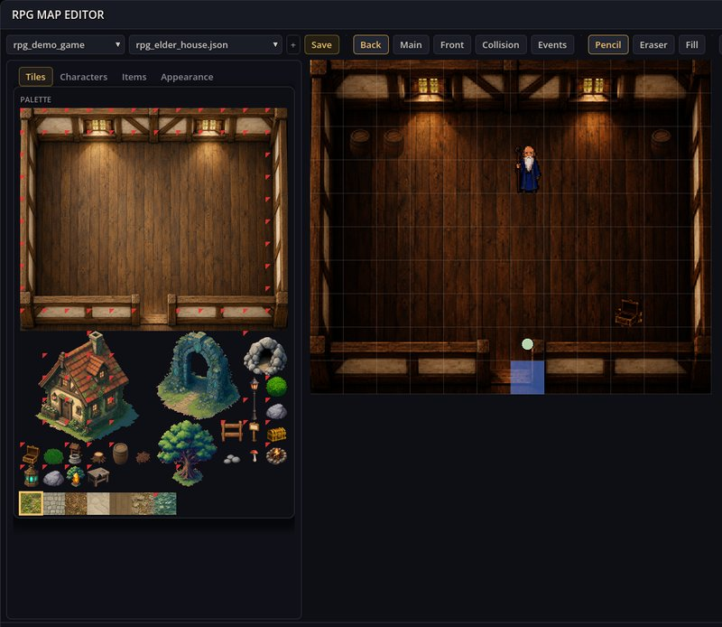

# Village Pack — RPG 타일 맵과 전투 아트

재사용 가능한 RPG 아트와 오브젝트: 타일셋 9종, 보행 스프라이트, 전투 이미지, 일회성 보상 용기와 편집 가능한 숲·눈·먼지·비 프로필.

팩은 공용 그래픽, 오브젝트 템플릿과 환경 프로필을 제공합니다. 게임 맵, 퀘스트와 보상은 `rpg_plus_game`에 있습니다.


## 안에 무엇이 있나

### village 타일셋

데모 세계의 모든 맵이 `village` 타일셋을 씁니다. 두 부분으로 이루어집니다.

오브젝트는 칸에 놓입니다: 오두막, 신전 아치, 동굴 입구, 나무들, 덤불, 우물, 모닥불, 가로등, 울타리, 표지판, 통, 상자(닫힌 것과 열린 것), 작업대, 그리고 장작·돌·버섯 같은 주울 수 있는 물건들. 맨 위에는 오두막 내부가 있습니다. 촌장의 집이 쓰는 12 × 10짜리 방 그림 하나입니다.


표면은 영역 전체를 채우는 이음새 없는 지면 텍스처입니다: 풀, 자갈길, 흙, 옅은 돌바닥, 나무 바닥, 자갈 많은 숲길, 물.


일부 타일에는 RPG 엔진용 추가 속성이 있습니다: 물은 통과할 수 없고, 가로등과 창문은 광원을 가져 해 질 무렵과 밤에 맵 위에서 빛납니다.


### 계절 식생

네 개의 식생 타일셋은 같은 나무·덤불·그루터기·꽃을 여름, 가을, 잎 없는 늦가을, 눈 내린 겨울로 보여 줍니다: 참나무, 전나무, 자작나무, 버드나무, 단풍나무, 소나무, 둥근 덤불과 열매 덤불, 잘린 속빈 그루터기, 데이지와 제비꽃.


지면에는 기본 타일셋 하나를 쓰며 `Tilesets`로 다른 세트의 오브젝트를 빌릴 수 있습니다. 사막 서쪽 하얀 고개(`rpg_winter`)는 `snow`, `vegetation_winter`, `village`를 사용합니다.

### 사막과 눈

- `desert`: 모래와 바위 표면에 사막 오브젝트 — 흙벽돌 건물, 시장 차양, 야자수, 선인장, 마른 풀 — 을 갖춥니다. RPG Plus의 사막 맵 Dry March가 이것으로 그려져 있습니다.
- `snow`: 지면에는 기본 타일셋 하나를 쓰며 `Tilesets`로 다른 세트의 오브젝트를 빌릴 수 있습니다. 사막 서쪽 하얀 고개(`rpg_winter`)는 `snow`, `vegetation_winter`, `village`를 사용합니다.


### 캐릭터 시트: 걷기 스프라이트

각 캐릭터 시트는 3 × 4짜리 시트입니다: 네 방향(아래·왼쪽·오른쪽·위)마다 걷기 프레임 셋. 마을 세트에는 영웅, 촌장, 마을 사람, 상인, 슬라임, 늑대가 있습니다. 사막 세트는 전갈, 딱정벌레, 그리고 닫힌 상태와 열린 상태의 통을 더합니다.


### 전투 초상화와 배경

큰 초상화는 전투에 나선 이들을 보여 줍니다: 영웅, 슬라임, 늑대, 그리고 사막의 전갈과 딱정벌레.


세 개의 배경 — 초원, 숲, 사막 전초기지 — 는 맵에서 시작된 전투의 배경으로 쓰입니다. 초원과 숲에는 조명 시스템용 `_depth` 짝이 있습니다.


## 어디에서 보이나

Village Pack은 `rpg_plus` 게임의 일부입니다. 그 게임에서:

- 마을, 촌장의 집, 숲, 숲속 신전은 `village` 타일셋으로 그려지고;
- 사막 맵은 `desert`를 쓰며;
- 촌장, 상인, 마을 사람, 늑대, 슬라임, 전갈, 딱정벌레가 팩의 캐릭터 시트로 맵을 걷고;
- 전투에는 초상화가 표시되고, 맵 장면은 `village/meadow`, `village/forest`, `desert/outpost`를 전투 배경으로 씁니다.

타일 맵 편집기는 선택한 타일셋을 팔레트로 보여 줍니다. 여기는 촌장의 집을 연 화면: 오두막 내부, 오브젝트, 표면 견본이 곧 village 타일셋입니다.



## 내 RPG 콘텐츠에서 쓰기

1. 게임의 컬렉션에 `village_pack`을 포함하세요. 엔진 모드 `rpg`가 필요합니다.
2. 그 아트를 쓰는 콘텐츠 모드의 `depends` 목록에 `village_pack>=1`을 추가하세요.
3. 아트는 이름으로 참조합니다:

```jsonc
// 맵: 맵 전체에 하나의 타일셋
{ "Kind": "rpg_map", "Items": [ { "Id": "my_glade", "Tileset": "village" /* … */ } ] }
```

```jsonc
// 캐릭터 시트로 그린 맵 이벤트
{ "Id": "old_man", "X": 5, "Y": 3, "Sprite": "village/elder" }
```

```jsonc
// 캐릭터의 전투 초상화
{ "Id": "my_wolf", "Image": "characters/village/wolf" }
```

```json
{
  "name": "my_glade",
  "defaultBackground": "village/meadow"
}
```

타일셋 이름은 `village`, `vegetation_summer`, `vegetation_autumn`, `vegetation_bare`, `vegetation_winter`, `desert`, `snow`입니다. 캐릭터 시트는 `village/<name>`과 `desert/<name>`, 전투 배경은 `village/meadow`, `village/forest`, `desert/outpost`입니다.

그리기 가장 쉬운 방법은 RPG 맵 편집기입니다: 맵의 타일셋으로 `village`를 고르면 타일 번호를 입력하는 대신 팔레트로 그릴 수 있습니다.

## 한계와 교체

- 지면에는 기본 타일셋 하나를 쓰며 `Tilesets`로 다른 세트의 오브젝트를 빌릴 수 있습니다. 사막 서쪽 하얀 고개(`rpg_winter`)는 `snow`, `vegetation_winter`, `village`를 사용합니다.
- 아트에는 조명과 원근가 구워져 있습니다. 2.5D 느낌을 위해 그려졌고, 아이소메트릭 렌더러도 같은 그림을 재활용하기 때문에 아주 높은 오브젝트는 그려진 각도를 유지합니다.
- 내 게임용으로 그림을 바꾸려면, 같은 상대경로 이름의 파일을 자신의 모드에 넣고 `village_pack`에 의존하세요. 나중에 로드되는 의존 모드가 이깁니다.
- 최초 생성물, 프롬프트, 편집 가능한 소스는 게임 밖에 보관되어 있습니다. 모드 안에는 실행용 그림과 타일셋 정의만 들어 있습니다.

## 그림이 이상할 때

1. 지면이나 오브젝트가 없는 맵은 대개 `Tileset` 이름을 잘못 썼거나 의존성이 빠진 것입니다.
2. 캐릭터가 안 보이면: `Sprite` 이름과 캐릭터 시트가 3 × 4 프레임인지 확인하세요.
3. 전투 배경이 단색이라면: 맵 장면에 `defaultBackground`가 없습니다.

## 재사용 오브젝트와 환경

맵 편집기의 **오브젝트**에서 `chest`나 `village_pack/barrel`을 배치합니다. 개별 인스턴스에 열림 상태, 빈 용기 메시지와 열린 모습이 있습니다. 통화와 보상은 편집기에서 설정합니다. 원문은 영어이며 7개 언어는 현지화 키를 사용합니다.

환경 필드에서 `woodland`, `winter_snow`, `desert_dust`, `rain`을 고릅니다. `atmospheres/weather.json` 프로필을 새 Id로 복사해 입자 수·색·크기·높이·속도를 바꿉니다. 모든 로드된 모드의 프로필이 표시됩니다. Effects Engine에서 방출기 유형을 확장할 수 있으며 렌더러 수정은 필요 없습니다.


## 설원 적

흰늑대, 바다코끼리, 북극곰, 예티를 포함합니다. 이름은 7개 언어로 제공되며 전투 이미지와 투명 배경의 3 × 4 보행 시트가 있습니다. ID는 순서대로 `village_pack/white_wolf`, `village_pack/walrus`, `village_pack/polar_bear`, `village_pack/yeti`입니다.

하얀 고개(`rpg_winter`)를 순찰합니다. 가까이에서 E/F를 누르면 전투가 시작되며, 승리하면 해당 적이 사라지고 저장 후에도 유지됩니다. 공격과 방어를 사용하고 영입할 수 없습니다. 전리품은 게임의 패치로 지정할 수 있습니다. 체력/공격/방어/경험치는 순서대로 24/5/0/14, 32/5/2/20, 40/7/1/28, 48/8/1/36입니다.

## 확장된 마을과 공용 실내

`habitat_objects`와 `habitat_interiors`에 외관 6종, 실내 6종, 야외 소품 7종, 가구 3종으로 총 22개 리소스를 추가했습니다. 마을과 숲에는 목조 주택, 사막에는 흙벽돌집과 대상 여관, 설원에는 오두막과 산장을 배치했습니다. 동일한 PNG를 일반 투영과 등각 투영에서 사용합니다. 각 12 × 10 방의 바닥, 벽, 남쪽 두 칸 출입구를 `IsoPlanes`로 대응시키며 가구는 독립되어 있습니다.

건물 7채에 출입할 수 있습니다. 마을 64 × 42, 숲 60 × 42, 사막 72 × 48, 설원 72 × 52, 성역 48 × 36으로 확장했으며 기존 이벤트와 이동 지점의 좌표를 유지했습니다. 문 이벤트는 이 팩에, 맵과 실내 장면은 `rpg_plus_game`에 있습니다.


