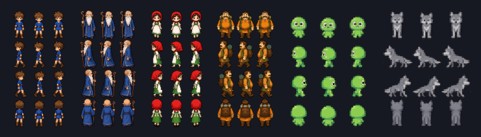

# Village Pack — графика для RPG-карт и боёв

Графика и объекты для RPG: девять тайлсетов, спрайты персонажей, боевые изображения, одноразовые контейнеры и редактируемые профили леса, снега, пыли и дождя.

Пак содержит общую графику, шаблоны объектов и профили окружения. Карты игры, задания и награды находятся в `rpg_plus_game`.


## Что внутри

### Тайлсет village

Тайлсетом `village` нарисована каждая карта демо-мира. У него две части.

Объекты ставятся на клетки: коттедж, арка святилища, вход в пещеру, деревья, кусты, колодец, костёр, фонарные столбы, забор, указатель, бочки, сундуки (закрытые и открытые), верстак и подбираемые предметы — хворост, камни, гриб. Наверху — интерьер коттеджа, единая картинка комнаты 12 × 10, которую использует дом старейшины.


Поверхности — бесшовные текстуры земли, заливающие целые области: трава, мощёная дорожка, земля, светлый каменный пол, деревянный пол, каменистая лесная тропа и вода.


У некоторых тайлов есть свойства для RPG-движка: вода непроходима, а фонари и окна несут источник света, который светится на карте в сумерках и ночью.


### Сезонная растительность

Четыре тайлсета растительности показывают одни и те же деревья, кусты, пни и цветы летом, осенью, в «голом» позднеосеннем виде и в снежной зиме: дуб, ель, берёза, ива, клён и сосна, круглые и ягодные кусты, спиленные и дуплистые пни, ромашки и фиалки.


У карты один основной тайлсет поверхностей; объекты других тайлсетов подключаются через `Tilesets`. Белый перевал (`rpg_winter`) на западе от пустыни использует `snow`, а также объекты `vegetation_winter` и `village`.

### Пустыня и снег

- `desert`: песок, каменистая почва, светлая вода оазиса, влажный прибрежный ил и протоптанный песок с пустынными объектами — глинобитными постройками, рыночным навесом, пальмами, кактусами и сухой травой. Пустынная карта RPG Plus, Dry March, нарисована им.
- `snow`: У карты один основной тайлсет поверхностей; объекты других тайлсетов подключаются через `Tilesets`. Белый перевал (`rpg_winter`) на западе от пустыни использует `snow`, а также объекты `vegetation_winter` и `village`.


### Чарсеты: шагающие спрайты

Каждый чарсет — лист 3 × 4: три кадра шага для каждого из четырёх направлений (вниз, влево, вправо, вверх). В деревенском наборе есть герой, старейшина, житель, торговец, слайм и волк. Пустынный набор персонажей добавляет скорпиона и жука. Закрытый и открытый вид бочки хранится отдельно в `object_sprites/desert/`; это изображения объекта, а не персонажа. Каждое состояние бочки — отдельный PNG 32×32 с одной картинкой. Формат 3×4 используется только для ходьбы персонажей.



### Боевые портреты и фоны

Большие портреты показывают сражающихся в бою: героя, слайма и волка, а также пустынных скорпиона и жука.


Три фона — луг, лес и пустынный форпост — служат фоном боя, начавшегося на карте. У луга и леса есть `_depth`-спутники для системы освещения.


## Где вы это увидите

Village Pack входит в игру `rpg_plus`. В ней:

- деревня, дом старейшины, лес и лесное святилище нарисованы тайлсетом `village`;
- пустынная карта использует `desert`;
- по картам ходят старейшина, торговец, жители, волки, слаймы, скорпионы и жуки — чарсетами пака;
- в боях показываются портреты, а сцены карт берут `village/meadow`, `village/forest` или `desert/outpost` как фон сражения.

Тайловый редактор показывает выбранный тайлсет как свою палитру. Здесь открыт дом старейшины: интерьер коттеджа, объекты и образцы поверхностей — это тайлсет village.


## Используйте его в своём RPG-контенте

1. Включите `village_pack` в коллекцию своей игры. Он требует движковый мод `rpg`.
2. Добавьте `village_pack>=1` в список `depends` контентного мода, который пользуется его графикой.
3. Обращайтесь к графике по имени:

```jsonc
// Карта: один тайлсет на всю карту
{ "Kind": "rpg_map", "Items": [ { "Id": "my_glade", "Tileset": "village" /* … */ } ] }
```

```jsonc
// Событие карты, нарисованное чарсетом
{ "Id": "old_man", "X": 5, "Y": 3, "Sprite": "village/elder" }
```

```jsonc
// Боевой портрет персонажа
{ "Id": "my_wolf", "Image": "characters/village/wolf" }
```

```json
{
  "name": "my_glade",
  "defaultBackground": "village/meadow"
}
```

Имена тайлсетов — `village`, `vegetation_summer`, `vegetation_autumn`, `vegetation_bare`, `vegetation_winter`, `desert` и `snow`. Чарсеты — `village/<name>` и `desert/<name>`; фоны боёв — `village/meadow`, `village/forest` и `desert/outpost`.

Проще всего рисовать в редакторе RPG-карт: выберите `village` тайлсетом карты и рисуйте палитрой вместо ручного ввода номеров тайлов.

## Ограничения и замена

- У карты один основной тайлсет поверхностей; объекты других тайлсетов подключаются через `Tilesets`. Белый перевал (`rpg_winter`) на западе от пустыни использует `snow`, а также объекты `vegetation_winter` и `village`.
- У графики запечённые свет и перспектива. Она нарисована под 2.5D-вид; изометрический рендерер переиспользует те же картинки, поэтому очень высокие объекты сохраняют нарисованный ракурс.
- Чтобы заменить картинку для своей игры, положите в свой мод файл с тем же относительным именем и объявите зависимость от `village_pack`. Побеждает загруженный позже зависимый мод.
- Исходные генерации, промпты и редактируемые исходники хранятся в архиве вне игры; в моде — только готовые картинки и определения тайлсетов.

## Если картинка выглядит неправильно

1. Карта без земли или объектов обычно означает опечатку в имени `Tileset` или пропавшую зависимость.
2. Невидимый персонаж: проверьте имя `Sprite` и что лист чарсета — 3 × 4 кадра.
3. Бой с однотонным фоном: у сцены карты нет `defaultBackground`.

## Общие объекты и окружение

В редакторе карты откройте **Объекты** и разместите `chest` или `village_pack/barrel`. У каждого экземпляра свой флаг открытия, сообщение о пустоте и открытый вид. В шаблоне нет валюты или наград конкретной игры: задайте их в редакторе объектов или размещённом экземпляре. Исходный текст шаблонов английский; все семь языков используют ключи локализации.

В поле «Окружение» карты выберите `woodland`, `winter_snow`, `desert_dust` или `rain`. Профили находятся в `atmospheres/weather.json`: скопируйте профиль с новым Id и меняйте число частиц, цвет, размер, высоту и скорость. Список собирается из всех загруженных модов. Механизм принадлежит Effects Engine и позволяет добавлять новые типы источников; названия биомов не зашиты в рендеры.


## Враги снежного биома

Пакет содержит четырёх врагов: белого волка, моржа, белого медведя и йети. У каждого есть боевой портрет, прозрачный лист ходьбы 3 × 4 и имя на семи языках.

| ID | Имя | Уровень | Здоровье | Защита | Атака | Опыт |
|---|---|---:|---:|---:|---:|---:|
| `village_pack/white_wolf` | Белый волк | 2 | 24 | 0 | 5 | 14 |
| `village_pack/walrus` | Морж | 3 | 32 | 2 | 5 | 20 |
| `village_pack/polar_bear` | Белый медведь | 4 | 40 | 1 | 7 | 28 |
| `village_pack/yeti` | Йети | 5 | 48 | 1 | 8 | 36 |

Используются обычный боевой ИИ, атака и защита, одно очко действия; приручение отключено. Таблицы добычи пустые: игра может назначить награды патчами персонажей. Кадр волка — 48 × 48, остальных — 64 × 64. Ряды: вниз, влево, вправо, вверх; столбцы: шаг, покой, шаг. В редакторе карты все четыре определения доступны как враги со своим `Charset`.

Патрули — расстановки в `rpg_plus_game` (`placements/rpg_winter/snow_enemies.json`): четыре коротких патруля на Белом перевале RPG Plus, карта не заменяется. Подойдите к врагу и нажмите E/F для боя. После победы исчезает только побеждённый экземпляр; результат сохраняется. Вход, выход и контейнеры доступны. Морж патрулирует замёрзший пруд. События используются, только если игра содержит карту `rpg_winter`.

## Расширенные поселения и общие интерьеры

Два новых тайлсета, `habitat_objects` и `habitat_interiors`, содержат 22 сгенерированных ресурса: шесть фасадов, шесть интерьеров, семь предметов окружения и три предмета мебели. Для деревни и леса добавлены фахверковый дом и лесной сруб, для пустыни — глинобитный дом и караванный двор, для зимы — северная изба и горный приют. Окружение включает рынок, поленницу, цистерну, амфоры, грузовые сани, сигнальный фонарь и обелиск святилища. Кровати, столы и печи размещаются отдельно.

Обычная и изометрическая проекции используют одни и те же PNG-атласы. Каждая комната размечена как цельная сетка 12 × 10: проходимый пол, стены и южный порог шириной две клетки. Измеренные границы исходного изображения приведены к этой сетке; `IsoPlanes` размещает те же пиксели на плоскостях пола и стен. Мебель имеет отдельные коллизии и якоря глубины. Многоклеточные объекты сохраняют цельные группы и общую точку сортировки.

В семь зданий можно войти через обычные переходы карты; два экземпляра лесного сруба возвращают каждый к своему входу. Пять наружных карт расширены. Исходные события, точки появления и переходы сохранены на прежних координатах. Новые кварталы соединены дорожками и дополнены цельными группами сезонной растительности.

| Карта | Было | Стало |
|---|---:|---:|
| `rpg_village` | 32 × 18 | 64 × 42 |
| `rpg_forest` | 28 × 18 | 60 × 42 |
| `rpg_desert` | 40 × 24 | 72 × 48 |
| `rpg_winter` | 40 × 28 | 72 × 52 |
| `rpg_woodland_shrine` | 24 × 16 | 48 × 36 |

Игровые изображения и события дверей находятся в этом пакете, расширенные карты и сцены интерьеров — в `rpg_plus_game`. Исходники, точные промпты, разметка и воспроизводимый сборщик хранятся вне репозиториев в `art_sources/cthangover/village_pack/art_sources/biome_expansion_20261029`.


### Поверхности пустынного оазиса

В палитре `desert` доступны пять материалов: `0` — рыхлый песок, `1` — каменистая земля,
`2` — светлая вода (`water`, непроходимая), `3` — прибрежный ил (`oasis_silt`),
`4` — утоптанная песчаная тропа (`desert_path`). Берег и тропы проходимы.
Рисуйте их на слое «Фон»: переходы между поверхностями рассчитывает движок в обеих проекциях.

На карте `rpg_desert` есть небольшой оазис вокруг клетки (25,24) с илистым берегом и
тропинкой от поселения. Новые кисти можно использовать на любых картах с набором `desert`.
