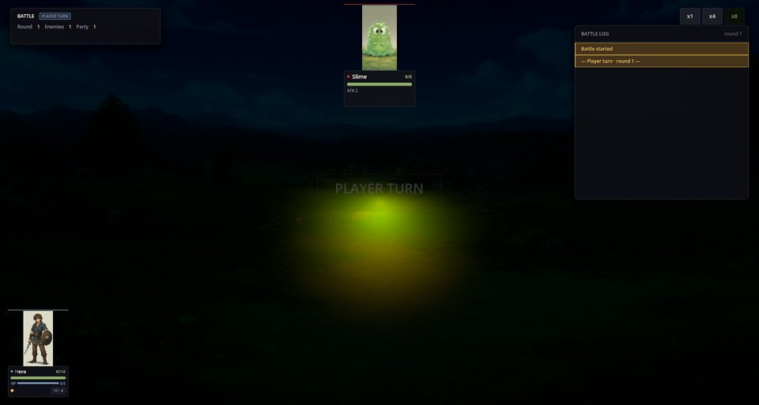
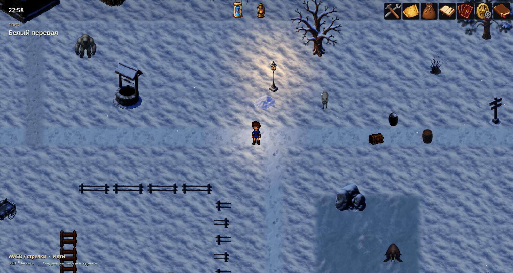

# Village Pack — art cho bản đồ RPG và chiến đấu

Đồ họa và đối tượng RPG tái sử dụng: chín bộ ô, sprite đi bộ, ảnh chiến đấu, vật chứa dùng một lần và hồ sơ rừng, tuyết, bụi, mưa có thể chỉnh sửa.

Gói chứa đồ họa, mẫu đối tượng và hồ sơ môi trường dùng chung. Bản đồ, nhiệm vụ và phần thưởng thuộc `rpg_plus_game`.


## Bên trong có gì

### Tileset village

Mọi bản đồ của thế giới demo đều dùng tileset `village`. Nó có hai phần.

Vật thể đặt trên ô: nhà tranh, cổng đền, miệng hang, cây cối, bụi cây, giếng nước, đống lửa, cột đèn, hàng rào, biển chỉ dẫn, thùng gỗ, rương (đóng và mở), bàn chế tạo và các vật nhặt được như củi, đá và nấm. Phía trên là nội thất nhà tranh, một bức tranh phòng 12 × 10 duy nhất mà nhà trưởng làng dùng.


Bề mặt là kết cấu nền liền mạch phủ cả một vùng: cỏ, đường lát đá, đất, sàn đá sáng màu, sàn gỗ, đường mòn rừng nhiều đá và nước.


Một số tile có thuộc tính thêm cho engine RPG: nước là rắn, còn đèn đường và cửa sổ mang nguồn sáng tỏa sáng trên bản đồ lúc chạng vạng và ban đêm.


### Thực vật theo mùa

Bốn tileset thực vật thể hiện cùng một bộ cây, bụi, gốc cây và hoa vào mùa hè, mùa thu, một phiên bản trơ trụi cuối thu và mùa đông có tuyết: sồi, vân sam, bạch dương, liễu, phong và thông, bụi tròn và bụi quả mọng, gốc cây bị chặt và gốc rỗng, cúc và violet.


Bản đồ dùng một bộ ô chính cho mặt đất và có thể mượn đối tượng qua `Tilesets`. Đèo Trắng (`rpg_winter`), phía tây sa mạc, dùng `snow`, `vegetation_winter` và `village`.

### Sa mạc và tuyết

- `desert`: bề mặt cát và đá cùng vật thể sa mạc — nhà đất nện, mái che chợ, cây cọ, xương rồng và cỏ khô. Bản đồ sa mạc của RPG Plus, Dry March, được vẽ bằng nó.
- `snow`: Bản đồ dùng một bộ ô chính cho mặt đất và có thể mượn đối tượng qua `Tilesets`. Đèo Trắng (`rpg_winter`), phía tây sa mạc, dùng `snow`, `vegetation_winter` và `village`.


### Charset: sprite đi bộ

Mỗi charset là một bảng 3 × 4: ba khung đi bộ cho mỗi một trong bốn hướng (xuống, trái, phải, lên). Bộ làng có anh hùng, trưởng làng, dân làng, thương nhân, slime và sói. Bộ sa mạc thêm bọ cạp, bọ hung và chiếc thùng ở trạng thái đóng và mở.


### Chân dung và phông nền chiến đấu

Các chân dung cỡ lớn hiện người chiến đấu trong trận: anh hùng, slime và sói, cùng bọ cạp và bọ hung của sa mạc.


Ba phông nền — bãi cỏ, khu rừng và tiền đồn sa mạc — dùng làm nền cho trận đánh bắt đầu trên bản đồ. Bãi cỏ và khu rừng có kèm ảnh `_depth` cho hệ thống chiếu sáng.




## Bạn sẽ thấy nó ở đâu

Village Pack là một phần của game `rpg_plus`. Trong game đó:

- làng, nhà trưởng làng, khu rừng và đền trong rừng được vẽ bằng tileset `village`;
- bản đồ sa mạc dùng `desert`;
- trưởng làng, thương nhân, dân làng, sói, slime, bọ cạp và bọ hung đi lại trên bản đồ bằng charset của gói;
- trận đánh hiện chân dung, và cảnh của bản đồ dùng `village/meadow`, `village/forest` hoặc `desert/outpost` làm phông trận đánh.

Trình soạn thảo bản đồ tile hiển thị tileset đã chọn làm bảng màu. Ở đây nhà trưởng làng đang mở: nội thất nhà tranh, các vật thể và mẫu bề mặt chính là tileset village.


## Dùng nó trong nội dung RPG của bạn

1. Đưa `village_pack` vào bộ sưu tập của game. Nó cần engine mod `rpg`.
2. Thêm `village_pack>=1` vào danh sách `depends` của mod nội dung dùng art của nó.
3. Tham chiếu art theo tên:

```jsonc
// Một bản đồ: một tileset cho cả bản đồ
{ "Kind": "rpg_map", "Items": [ { "Id": "my_glade", "Tileset": "village" /* … */ } ] }
```

```jsonc
// Sự kiện bản đồ vẽ bằng charset
{ "Id": "old_man", "X": 5, "Y": 3, "Sprite": "village/elder" }
```

```jsonc
// Chân dung chiến đấu của nhân vật
{ "Id": "my_wolf", "Image": "characters/village/wolf" }
```

```json
{
  "name": "my_glade",
  "defaultBackground": "village/meadow"
}
```

Các tên tileset là `village`, `vegetation_summer`, `vegetation_autumn`, `vegetation_bare`, `vegetation_winter`, `desert` và `snow`. Charset là `village/<name>` và `desert/<name>`; phông nền là `village/meadow`, `village/forest` và `desert/outpost`.

Cách vẽ đơn giản nhất là trình soạn thảo bản đồ RPG: chọn `village` làm tileset của bản đồ rồi vẽ bằng bảng màu thay vì gõ số tile.

## Giới hạn và thay thế

- Bản đồ dùng một bộ ô chính cho mặt đất và có thể mượn đối tượng qua `Tilesets`. Đèo Trắng (`rpg_winter`), phía tây sa mạc, dùng `snow`, `vegetation_winter` và `village`.
- Art có sẵn ánh sáng và phối cảnh được "nướng" sẵn. Nó vẽ cho vẻ 2.5D; trình dựng isometric dùng lại đúng những hình đó, nên vật thể quá cao vẫn giữ góc nhìn như đã vẽ.
- Để thay một hình cho game của bạn, hãy đặt vào mod của mình một tệp trùng tên tương đối và khai báo phụ thuộc `village_pack`. Mod phụ thuộc nạp sau sẽ thắng.
- Các bản sinh gốc, prompt và nguồn có thể chỉnh sửa đều được lưu trữ ngoài game; trong mod chỉ có ảnh chạy thời gian thực và định nghĩa tileset.

## Nếu hình trông sai sai

1. Bản đồ thiếu nền hoặc vật thể thường do tên `Tileset` gõ sai hoặc thiếu phụ thuộc.
2. Nhân vật vô hình: kiểm tra tên `Sprite` và bảng charset có đủ 3 × 4 khung không.
3. Trận đánh nền trơn: cảnh của bản đồ không có `defaultBackground`.

## Đối tượng và môi trường dùng chung

Trong **Đối tượng** của trình sửa bản đồ, đặt `chest` hoặc `village_pack/barrel`. Mỗi đối tượng có cờ mở, thông báo rỗng và hình mở riêng. Mẫu không gắn tiền tệ hay phần thưởng; hãy đặt trong trình sửa. Văn bản nguồn là tiếng Anh; bảy ngôn ngữ dùng khóa bản địa hóa.

Chọn `woodland`, `winter_snow`, `desert_dust` hoặc `rain` ở trường môi trường. Sao chép hồ sơ trong `atmospheres/weather.json` với Id mới để đổi số hạt, màu, kích thước, độ cao và vận tốc. Danh sách lấy từ mọi mod đã tải. Effects Engine cho phép thêm loại bộ phát mà không sửa bộ kết xuất.




## Kẻ địch vùng tuyết

Gói có sói trắng, hải mã, gấu Bắc Cực và người tuyết, với tên bằng bảy ngôn ngữ, ảnh chiến đấu và bộ ảnh di chuyển nền trong suốt 3 × 4. ID lần lượt là `village_pack/white_wolf`, `village_pack/walrus`, `village_pack/polar_bear`, `village_pack/yeti`.

Chúng tuần tra ở Đèo Trắng (`rpg_winter`). Đến gần và nhấn E/F để chiến đấu. Kẻ địch bị đánh bại sẽ biến mất và trạng thái được lưu lại. Chúng dùng tấn công và phòng thủ, không thể chiêu mộ. Trò chơi có thể đặt chiến lợi phẩm bằng bản vá. Máu/tấn công/phòng thủ/kinh nghiệm lần lượt là 24/5/0/14, 32/5/2/20, 40/7/1/28 và 48/8/1/36.

## Khu dân cư và nội thất mở rộng

`habitat_objects` và `habitat_interiors` bổ sung 22 tài nguyên: sáu mặt ngoài nhà, sáu nội thất, bảy vật trang trí ngoài trời và ba món đồ nội thất. Làng và rừng có nhà gỗ, sa mạc có nhà đất và quán trọ lữ hành, vùng tuyết có nhà gỗ và nhà trọ trên núi. Cùng một PNG được dùng cho cả hai phép chiếu. Mỗi phòng 12 × 10 có sàn, tường và cửa phía nam rộng hai ô, được ánh xạ bằng `IsoPlanes`; đồ đạc đặt độc lập.

Có thể ra vào bảy tòa nhà. Kích thước mới: làng 64 × 42, rừng 60 × 42, sa mạc 72 × 48, vùng tuyết 72 × 52, đền 48 × 36. Các sự kiện và lối chuyển cảnh cũ giữ nguyên tọa độ. Cửa thuộc gói này; bản đồ và cảnh nội thất thuộc `rpg_plus_game`.


