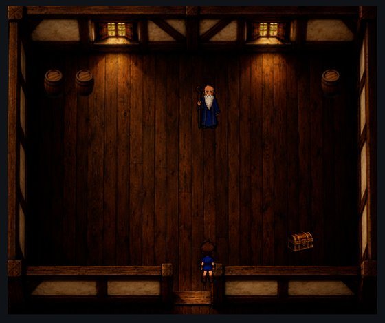
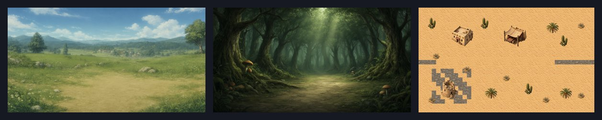

# Village Pack — RPG 图块地图与战斗美术

可复用的 RPG 美术与对象：九套图块、行走精灵、战斗图像、一次性容器，以及可编辑的林地、雪、尘埃和雨配置。

素材包包含可复用的图像、对象模板和环境配置。游戏地图、任务和奖励属于 `rpg_plus_game`。


## 里面有什么

### village 图块集

演示世界的每张地图都用 `village` 图块集。它分两部分。

物件放置在格子 上：小屋、神社拱门、洞口、树木、灌木、水井、篝火、路灯、栅栏、告示牌、木桶、宝箱（关闭和打开两种）、工作台，以及可拾取物——柴火、石块和蘑菇。最上方是小屋内部，一整张 12 × 10 的房间图，长老之家用的就是它。


表面是无缝的地面纹理，用来铺满整片区域：草地、石板路、泥土、浅色石地板、木地板、多石的林间小径和水。


部分图块带有 RPG 引擎用的额外属性：水不可通行，路灯和窗户自带光源，黄昏和夜晚会在地图上发光。



### 四季植被

四个植被图块集用夏季、秋季、深秋的光秃版和落雪的冬季展示同一批树木、灌木、树桩和花：橡树、云杉、桦树、柳树、枫树和松树，圆形灌木和浆果灌木，砍断的和空心的树桩，雏菊和紫罗兰。


地图使用一套主地表图块，并可通过 `Tilesets` 借用其他图块集的对象。沙漠以西的白色山口（`rpg_winter`）使用 `snow`，并借用 `vegetation_winter` 和 `village`。

### 沙漠与雪地

- `desert`：沙地和岩石表面加沙漠物件——土坯建筑、集市遮阳篷、棕榈、仙人掌和干草。RPG Plus 的沙漠地图 Dry March 就是用它画的。
- `snow`: 地图使用一套主地表图块，并可通过 `Tilesets` 借用其他图块集的对象。沙漠以西的白色山口（`rpg_winter`）使用 `snow`，并借用 `vegetation_winter` 和 `village`。


### 行走图（charset）

每个行走图是一张 3 × 4 表：四个朝向（下、左、右、上）各有三帧行走画面。村庄组包含英雄、长老、村民、商人、史莱姆和狼。沙漠组增加了蝎子、甲虫，以及关闭和打开两种状态的木桶。


### 战斗立绘与背景

大幅立绘展示战斗中的角色：英雄、史莱姆和狼，以及沙漠的蝎子和甲虫。


三张背景——草地、森林和沙漠前哨——用作在地图上触发的战斗的背景。草地和森林带有供光照系统使用的 `_depth` 伴生图。




## 在哪里能看到它

Village Pack 属于 `rpg_plus` 游戏。在那个游戏里：

- 村庄、长老之家、森林和林间神社用 `village` 图块集绘制；
- 沙漠地图使用 `desert`；
- 长老、商人、村民、狼、史莱姆、蝎子和甲虫用包内行走图在地图上走动；
- 战斗会显示立绘，地图场景用 `village/meadow`、`village/forest` 或 `desert/outpost` 作战斗背景。

图块地图编辑器把选中的图块集显示为调色板。图中打开的是长老之家：小屋内部、物件和表面样块就是 village 图块集。


## 在自己的 RPG 内容中使用它

1. 把 `village_pack` 加进游戏的合集。它依赖引擎模组 `rpg`。
2. 把 `village_pack>=1` 加进使用其美术的内容模组的 `depends` 列表。
3. 按名称引用美术资源：

```jsonc
// 一张地图：整张地图只用一个图块集
{ "Kind": "rpg_map", "Items": [ { "Id": "my_glade", "Tileset": "village" /* … */ } ] }
```

```jsonc
// 用行走图绘制的地图事件
{ "Id": "old_man", "X": 5, "Y": 3, "Sprite": "village/elder" }
```

```jsonc
// 角色的战斗立绘
{ "Id": "my_wolf", "Image": "characters/village/wolf" }
```

```json
{
  "name": "my_glade",
  "defaultBackground": "village/meadow"
}
```

图块集名称为 `village`、`vegetation_summer`、`vegetation_autumn`、`vegetation_bare`、`vegetation_winter`、`desert` 和 `snow`。行走图为 `village/<name>` 和 `desert/<name>`；战斗背景为 `village/meadow`、`village/forest` 和 `desert/outpost`。

最省事的绘制方式是 RPG 地图编辑器：把 `village` 选为地图的图块集，然后用调色板作画，不必手输图块编号。

## 限制与替换

- 地图使用一套主地表图块，并可通过 `Tilesets` 借用其他图块集的对象。沙漠以西的白色山口（`rpg_winter`）使用 `snow`，并借用 `vegetation_winter` 和 `village`。
- 美术自带烘焙好的光照和透视。它按 2.5D 视角绘制；等距渲染器复用同一批图片，因此特别高的物件会保持绘制时的角度。
- 想为自己的游戏替换某张图，在自己模组里放一个相对名称相同的文件并声明依赖 `village_pack` 即可。后加载的依赖方胜出。
- 最初的生成图、提示词和可编辑源文件都归档在游戏之外；模组里只有运行时图片和图块集定义。

## 如果画面不对劲

1. 地图缺地面或缺物件，多半是 `Tileset` 名称拼写错误或缺少依赖。
2. 角色看不见：检查 `Sprite` 名称，以及行走图表是否为 3 × 4 帧。
3. 战斗背景是纯色：地图场景没有设置 `defaultBackground`。

## 可复用对象与环境

在地图编辑器的**对象**中放置 `chest` 或 `village_pack/barrel`。每个实例都有独立的开启状态、空容器提示和开启图像。模板不绑定货币或奖励，请在对象编辑器中设置。源文本为英语，七种语言使用本地化键。

在地图环境字段中选择 `woodland`、`winter_snow`、`desert_dust` 或 `rain`。复制 `atmospheres/weather.json` 的配置并使用新 Id，即可调整粒子数量、颜色、尺寸、高度和速度。列表包含所有已加载模组的配置。Effects Engine 支持扩展发射器类型，无需修改渲染器。


## 雪地敌人

资源包包含白狼、海象、北极熊和雪人，提供七种语言的名称、战斗立绘以及透明背景的3 × 4行走图。ID依次为 `village_pack/white_wolf`、`village_pack/walrus`、`village_pack/polar_bear`、`village_pack/yeti`。

它们在白色山口（`rpg_winter`）巡逻。靠近后按E/F进入战斗；胜利后对应敌人消失，存档会保留该状态。它们使用攻击和防御，无法招募。游戏可通过角色补丁设置掉落物。生命/攻击/防御/经验值依次为24/5/0/14、32/5/2/20、40/7/1/28和48/8/1/36。

## 扩展聚落与共用内景

`habitat_objects`和`habitat_interiors`新增22个资源：六种建筑外观、六种室内、七种户外摆件和三种家具。村庄与森林使用木构民居，沙漠使用土坯房与商旅客栈，雪地使用木屋与山间旅舍。普通投影和等距投影共用同一批PNG。每间12 × 10房间的地板、墙面和南侧两格门槛通过`IsoPlanes`映射，家具单独摆放。

共有七栋可进入建筑。村庄扩展至64 × 42、森林60 × 42、沙漠72 × 48、雪地72 × 52、圣域48 × 36；原有事件和传送点坐标保持不变。门事件位于本资源包，地图和室内场景位于`rpg_plus_game`。


